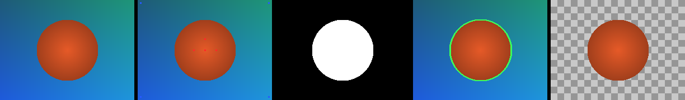

# Image Segmentation

Interactive foreground/background **image segmentation via s-t min-cut** in C++.



*(original -> seed scribbles -> binary mask -> boundary overlay -> cutout)*

## The idea: flow -> cut -> segmentation

1. Each pixel is a graph node. Add a **source** `s` (foreground) and a **sink** `t` (background) node.
2. **Data terms**: edges `s->pixel` ("looks like foreground") and `pixel->t` ("looks like background"), weighted by color distance to the user's seed scribbles. Seeded pixels get `INF` edges (hard constraints).
3. **Smoothness terms**: edges between 4-connected neighbors weighted:
    Gaussian kernel = `λ·exp(−‖Ip−Iq‖² / 2σ²)`: high between similar neighbors, so the cut prefers to run along real color edges (smooth boundaries).
4. Run **max-flow** ([Dinic's](src/maxflow.cpp)). By **max-flow/min-cut duality**, the min cut partitions pixels into foreground (still reachable from `s`) and background (reachable from `t`).
5. **The cut *is* the segmentation.**

## Build

```bash
cmake -S . -B build -DCMAKE_BUILD_TYPE=Release
cmake --build build -j
```

## Run

```bash
# Full demo: writes all artifacts + results/index.html gallery
./build/imageSegmentation data/sample.png data/sample.seeds results/ -- sweep

# Tune the smoothness term for a single run
./build/imageSegmentation data/sample.png data/sample.seeds results/ --lambda 100 --sigma 20

# Flags: --sweep (lambda montage), --lambda N, --sigma N, --no-html
```

Then open [`results/index.html`](results/index.html) in your browser to view the results.


